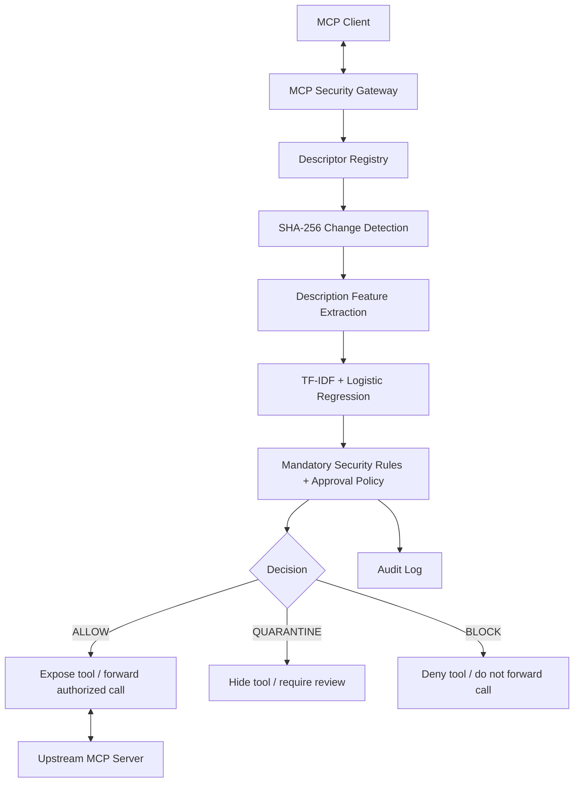

# MCP Security Gateway

A research prototype that places an application-layer security gateway between an MCP client and an MCP server. It focuses on detecting and containing malicious changes to MCP tool descriptions, including prompt-injection and credential-exfiltration instructions embedded in tool metadata.

> **Project status: experimental research prototype — not production-ready.**
>
> The current implementation is a Python MCP application-layer proxy. It is not an OS-level transparent proxy, network firewall, or container-isolation system.

## Overview

MCP servers expose tools to AI clients through operations such as `tools/list` and `tools/call`. A malicious or compromised server could introduce a new tool or modify an existing tool description so that an AI model is exposed to harmful instructions.

The gateway checks tool descriptors before exposing them to the client and checks authorization before forwarding tool calls.

### Main security flow



### Decision meanings

| Decision | Meaning |
|---|---|
| `ALLOW` | The descriptor is approved and the tool may be exposed and called. |
| `QUARANTINE` | The descriptor is new or changed and requires review. It is hidden from `tools/list`, and calls are rejected until approved. |
| `BLOCK` | A mandatory security rule or high-risk condition denies the descriptor or call. |

**Important:** A SHA-256 mismatch indicates that a descriptor changed. It does not, by itself, prove that the change is malicious. The ML detector estimates risk; mandatory rules and approval state are also considered by the policy engine.

## What is implemented

- Descriptor registration and SHA-256 change detection.
- Description-based ML risk scoring using TF-IDF word and character n-grams with Logistic Regression.
- Policy decisions: `ALLOW`, `QUARANTINE`, and `BLOCK`.
- MCP application-layer interception for `tools/list` and `tools/call`.
- Enforcement intended to prevent quarantined, blocked, or unregistered tools from reaching the upstream server.
- Human approval flow for promoting a reviewed descriptor to the trusted baseline.
- Audit logging.
- A harmless test MCP server and controlled security demonstration scenarios.
- Threshold-policy and MDP-policy comparison in a controlled simulator.

The primary scope is **tool-description poisoning and descriptor changes**. Runtime tool-argument sanitization and inspection of arbitrary tool implementation behavior are not the main focus of this prototype.

## Technology

- Python
- MCP Python SDK (v1 API line; the local environment used `mcp==1.30.0`)
- scikit-learn
- TF-IDF vectorization
- Logistic Regression
- SHA-256 descriptor fingerprints
- pytest
- AnyIO in-memory streams for protocol-level testing

## Dataset and model

The reported expanded experimental dataset contains:

- 538 records in total
- 485 malicious records
- 53 benign records
- 50 canonical server families (as reported by the dataset validation report)

The model uses the tool description text as its input. The reported feature pipeline combines:
- Word TF-IDF n-grams: `(1, 2)`
- Character-within-word TF-IDF n-grams: `(3, 5)`
- Logistic Regression with balanced class weights

Security labels and metadata are not intended to be used as model input features.

### Reported evaluation results

The following figures are from the project's reported evaluation artifacts. They are experimental results on the specified dataset and split, not guarantees of real-world detection performance.

| Evaluation | Threshold | Accuracy | Precision | Recall | FPR | FNR |
|---|---:|---:|---:|---:|---:|---:|
| Grouped cross-validation OOF | 0.50 | 98.33% | 98.57% | 99.59% | 7/53 (13.21%) | 2/485 (0.41%) |
| Grouped cross-validation OOF | 0.70 | 97.40% | 100% | 97.11% | 0/53 (0%) | 14/485 (2.89%) |
| Held-out test | 0.50 | 95.49% | 95.45% | 99.06% | 5/27 (18.52%) | 1/106 (0.94%) |
| Held-out test | 0.70 | 98.50% | 100% | 98.11% | 0/27 (0%) | 2/106 (1.89%) |

At threshold `0.70`, zero false positives were observed in the reported benign samples. This does **not** establish that the true population false-positive rate is zero. The reported exact 95% Clopper–Pearson upper bounds are approximately 6.72% for `0/53` and 12.77% for `0/27`.

The reported MDP simulation did not outperform the static threshold policy:
- Static threshold: mean reward `7.05 ± 0.18`, 8 simulated breaches.
- MDP: mean reward `7.00 ± 0.25`, 35 simulated breaches.

Therefore, this project does not claim that MDP is superior. The MDP work is an experimental policy comparison, not the primary attack detector.

## Requirements

- Windows PowerShell (commands below are for Windows).
- Python 3.14.8 was used in the latest reported local run.
- The project virtual environment and dependencies from `requirements.txt`.
- The trained model and vectorizer artifacts required by the demo.

The project uses the MCP SDK v1 API. The local environment previously encountered import errors when MCP SDK 2.x was installed. Keep the dependency pinned to the compatible version used by the project.

## Quick start (Windows PowerShell)

Run commands from the project root directory.

### 1. Open the project folder

Update the path if the project is stored elsewhere:

```powershell
Set-Location "C:\Users\hp\OneDrive\Desktop\mdp-mcp\mcp-security"
```

### 2. Create and activate the virtual environment

For a first-time setup:

```powershell
python -m venv .venv
Set-ExecutionPolicy -Scope Process -ExecutionPolicy Bypass
.\.venv\Scripts\Activate.ps1
```

### 3. Install dependencies

```powershell
python -m pip install --upgrade pip
python -m pip install -r requirements.txt
```

Ensure `requirements.txt` pins the MCP SDK to the compatible v1 release used by this project (the previously tested environment used `mcp==1.30.0`). Avoid installing MCP SDK 2.x into this environment unless the code has been migrated and tested for that API.

To verify the installed version:

```powershell
python -m pip show mcp
```

### 4. Run the automated test suite

```powershell
python -m pytest -v
```

Latest user-provided local run: **86 tests passed** in 11.24 seconds.

### 5. Run the security demonstration

```powershell
powershell -ExecutionPolicy Bypass -File scripts\run_demo.ps1
```

Latest user-provided local run: **all 9 demonstration scenarios completed successfully**.

The demo includes approved-tool access, new-tool quarantine, descriptor-change handling, prompt-injection blocking, credential-exfiltration blocking, high-privilege rule enforcement, direct-call bypass rejection, human approval, and threshold-versus-MDP comparison.

### Subsequent runs

After the environment has been created and dependencies installed, reopen PowerShell and run:

```powershell
Set-Location "C:\Users\hp\OneDrive\Desktop\mdp-mcp\mcp-security"
.\.venv\Scripts\Activate.ps1
python -m pytest -v
powershell -ExecutionPolicy Bypass -File scripts\run_demo.ps1
```

## Project structure

The following are the main project areas referenced by the implementation and its run/evaluation artifacts:

```text
mcp-security/
├── gateway/       # MCP gateway, descriptor checks, ML detector and policy
├── server/        # Harmless MCP test server
├── data/          # Experimental dataset files
├── models/        # Trained detector and vectorizer artifacts
├── training/      # Training, evaluation and audit reports
├── tests/         # Automated tests
├── scripts/       # Demo runner and PowerShell wrapper
├── docs/          # Setup, architecture, demo and troubleshooting guides
├── requirements.txt
└── README.md
```

See the actual files in each directory for the current module names and available commands.

## Research and audit artifacts

The project reports include the following artifacts (check that they are present in your checkout):

- `training/final_independent_audit.md` — independent audit summary and limitations.
- `training/final_verified_results.json` — reconciled evaluation results.
- `training/corrected_research_evaluation_report.md` — corrected research evaluation.
- `training/gateway_integration_report.md` — gateway integration test report.
- `training/real_mcp_e2e_report.md` — MCP protocol end-to-end test report.

Use repository-relative links when viewing these files on GitHub; do not use local `file:///C:/...` paths.

## Important limitations

- This is an application-layer Python MCP prototype, not an OS-level transparent stdio/socket proxy or network egress firewall.
- The reported protocol end-to-end tests used in-memory AnyIO streams. They do not, by themselves, demonstrate deployment across separate external processes or machines.
- Runtime tool arguments and arbitrary tool implementation behavior are outside the primary scope of the current description-focused detector.
- ML predictions can be wrong, especially for novel, subtle, multilingual, or adversarially phrased attacks. Mandatory security rules and human review remain important.
- The benign dataset and held-out benign test set are relatively small. Reported metrics should be interpreted with their sample sizes and confidence intervals.
- The descriptor registry is JSON-based; it is not equivalent to a tamper-resistant, cryptographically signed registry.
- Progressive/chunked streaming, high availability, and production deployment hardening have not been established by the reported tests.
- The latest demo output showed an additional `calculate_total` quarantine during the scenario targeting `simple_division`. Investigate this fixture/baseline behavior before presenting that scenario as a clean single-tool demonstration.

## Research prototype disclaimer

This project is intended for academic experimentation and evaluation of MCP tool-description security controls. It should not be deployed as a production security boundary without further independent testing, deployment hardening, stronger registry integrity controls, and broader adversarial evaluation.
